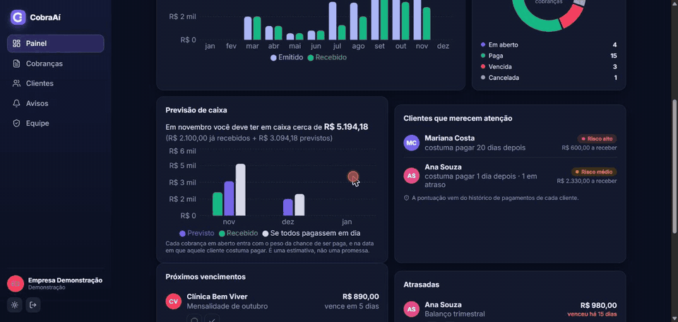
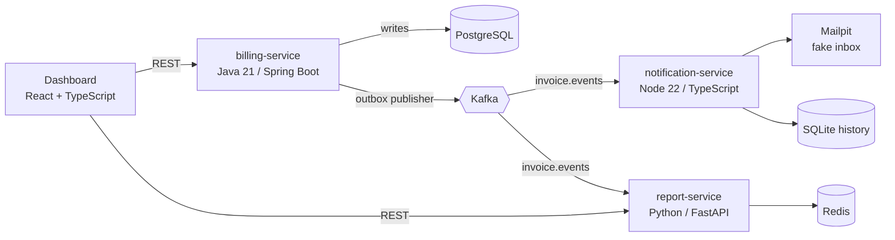
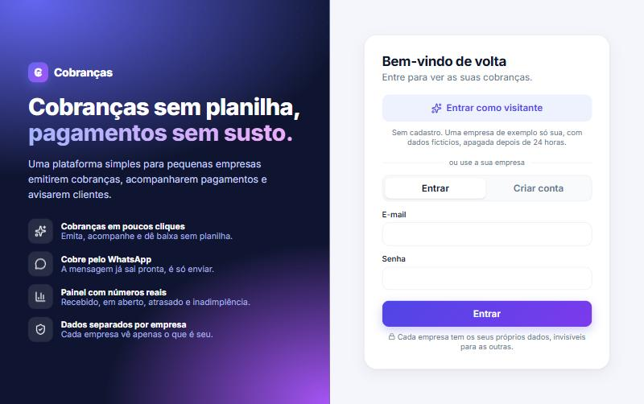
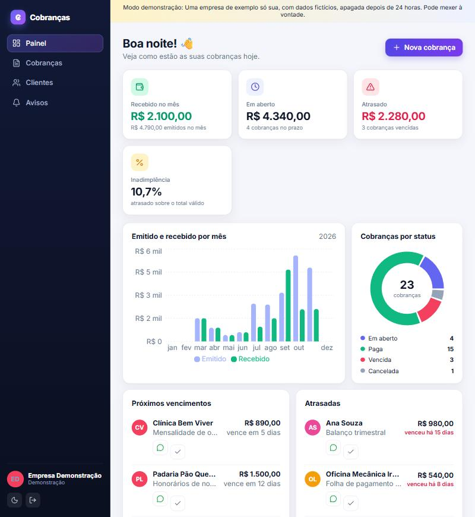
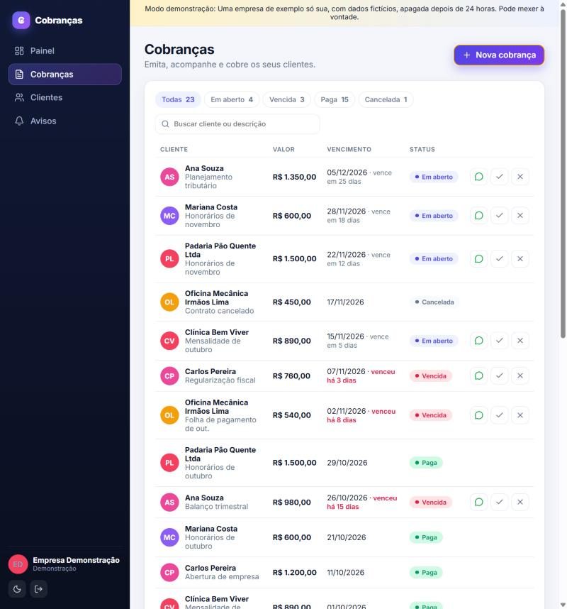
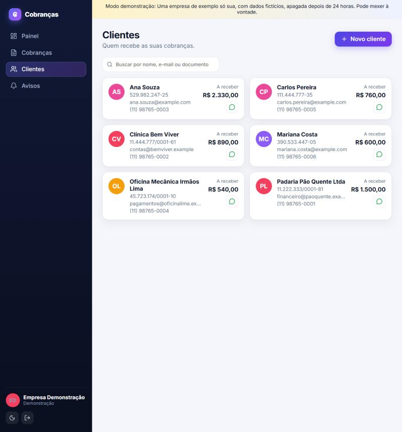
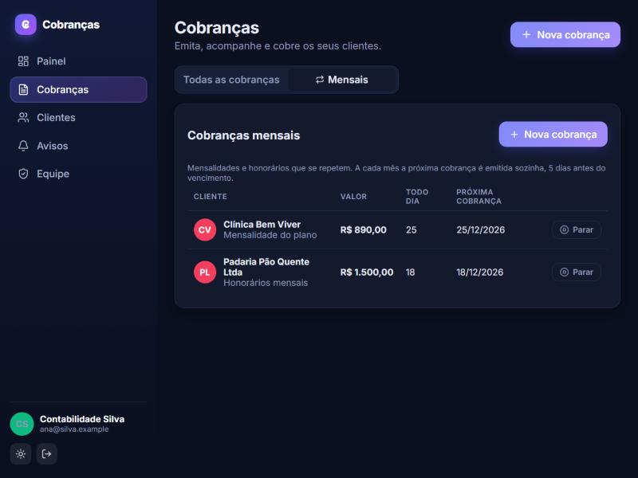
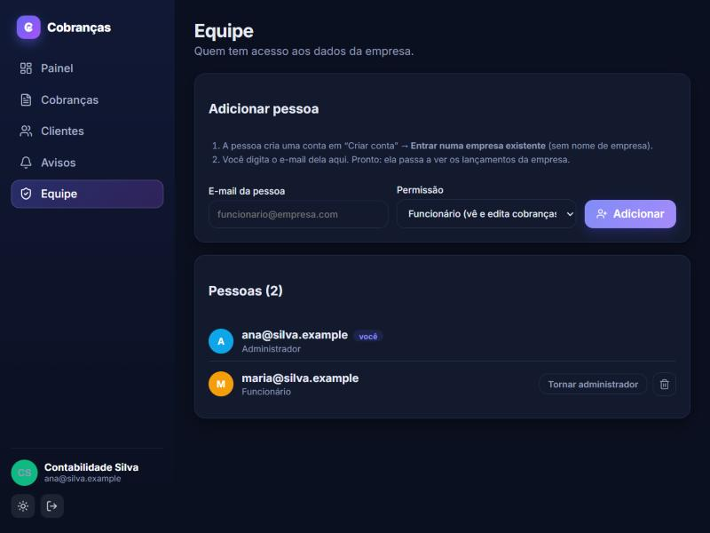
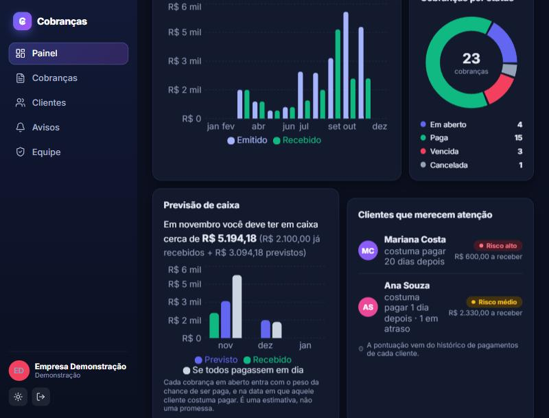
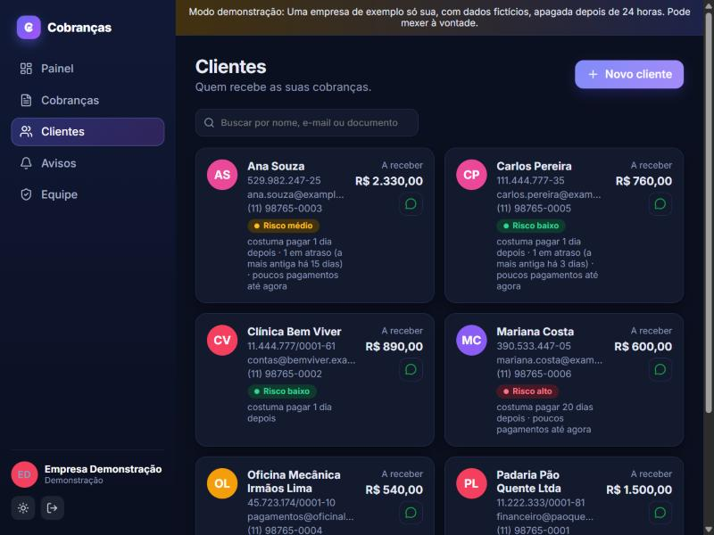

<p align="center"></p>

<h1 align="center">CobraAí</h1>

<p align="center"><b>Invoicing without spreadsheets.</b><br>
A billing system for small businesses, built as an <b>event-driven microservices</b> architecture<br>
(Java + Kafka + Python + Node + React) and running in the cloud with HTTPS.</p>

<p align="center"><a href="https://cobraai-wake.vercel.app"></a></p>

> The main README is in Portuguese: [README.md](README.md). This is the English version.



## For reviewers (30 seconds)

| | |
|---|---|
| **What it is** | A multi-company billing system: issues invoices, repeats the monthly ones, scores each customer's default risk, forecasts the next 3 months of cash, and opens the customer's WhatsApp with the message ready. |
| **Why it is not just a CRUD** | Three services in three languages talk through **Kafka events**, with a transactional outbox, idempotent consumers and per-key ordering. |
| **Is it live?** | Yes, with HTTPS, on an Azure VM that wakes up when someone arrives: [cobraai-wake.vercel.app](https://cobraai-wake.vercel.app). |
| **Is it tested?** | About **140 automated tests** plus about **100 end-to-end checks** against the running system, with CI on GitHub Actions. |
| **Where to look** | [`services/billing`](services/billing) (outbox, JWT, concurrency) and [`contracts/events.md`](contracts/events.md) (the event contract). |

**Try the demo.** Open the link above. If the system is asleep, press the button and wait about 1 minute (it runs on
free student credit and stops itself after 3 hours without use). Then press **Entrar como visitante** (visitor): you get
a private sample company. It is a portfolio demo: do not enter real customer data. The interface is in Portuguese.

## Microservices version



Only `billing-service` writes to PostgreSQL and publishes events. The other services just react to them, so each one
can fail or be replaced without taking the others down. No service reads another service's database.

## Run it

Requires Docker.

```bash
docker compose up --build
```

| What | URL |
|---|---|
| Site (log in, or press "Entrar como visitante") | http://localhost:5173 |
| Billing API | http://localhost:8080 |
| Report API | http://localhost:8000/docs |
| Notification API | http://localhost:3000/notifications (needs the login token) |
| Fake inbox (Mailpit): shows the e-mails of every company | http://localhost:8025 |
| Kafka UI: shows the messages of every company | http://localhost:8090 |

Try it: press **Entrar como visitante** (a private sandbox company with sample data), or create your own company account.
Add a customer (a valid CPF such as `529.982.247-25`, plus a WhatsApp number), issue an invoice, mark it as paid, then look
at the numbers on the dashboard, the e-mail in Mailpit and the messages in Kafka UI. A step-by-step guide with
screenshots is in [docs/GUIA-DE-USO.md](docs/GUIA-DE-USO.md).

Low on memory? Start only part of the stack: `docker compose up postgres kafka billing-service`.

## Design decisions (the interesting part)

* **Money in cents** (`amountCents`, `BIGINT`), never a decimal, to avoid rounding errors.
* **Transactional Outbox.** An invoice and its event are written in the same database transaction. A polling
  publisher sends unpublished rows to Kafka afterwards, so an event is never lost if the service crashes between
  "save" and "send". Nothing else talks to Kafka, not even the daily overdue job.
* **At-least-once delivery + idempotent consumers.** The publisher may send an event twice; every consumer stores
  the `eventId`s it processed and ignores repeats. In the report service the "processed" mark and the numbers are
  updated in one Redis transaction.
* **Ordering by key.** The Kafka key is the `invoiceId`, so all events of one invoice stay in order.
* **Report numbers are rebuildable.** Topics have infinite retention (`retention.ms=-1`) and Redis runs with AOF. If
  the numbers are lost, `python -m app.rebuild` wipes them (including the processed-ids list) and replays the topics
  from the beginning.
* **State per invoice in the report service.** Events do not carry the previous status, so the report service keeps
  each invoice's status. That is how `OVERDUE -> PAID` leaves the overdue total and `CANCELED` leaves the open total.
* **Business rules** are documented in the status table below and covered by tests; due dates are calendar days
  evaluated in `America/Sao_Paulo`; concurrent "pay" clicks are blocked by optimistic locking (`@Version`).
* **Correlation id.** `X-Correlation-Id` enters at the HTTP request, is copied into the event, and appears in the
  JSON logs of every service. Logs never contain CPF/CNPJ or full e-mail addresses.

### Invoice status rules

| From | Action | Result |
|---|---|---|
| OPEN | pay | PAID (`invoice.paid`) |
| OPEN | cancel | CANCELED (`invoice.canceled`) |
| OPEN | daily job, due date passed | OVERDUE (`invoice.overdue`) |
| OVERDUE | pay | PAID (`invoice.paid`) |
| OVERDUE | cancel | CANCELED (`invoice.canceled`) |
| PAID / CANCELED | pay or cancel | refused, `409 Conflict` |

An invoice with a due date in the past, a non-positive amount, or an invalid CPF/CNPJ is refused with `400`.
Event format: [contracts/events.md](contracts/events.md).

## Accounts and data isolation

Every company has its own login (e-mail and password) and sees only its own data.

```
browser --POST /auth/login--> billing-service ... checks the BCrypt password, signs a token (JWT, HS256) with the company id
browser --Authorization: Bearer <token>--> billing-service | report-service | notification-service
                                            each one verifies the signature with the shared secret and reads the company from the token
```

* **One login for three services.** The billing service signs the token; the report (Python) and notification (Node)
  services only verify it, so there is no user database to share and no session stored anywhere.
* **The company comes from the token, never from the request.** Controllers pass it to the services, and every query
  filters by it. Asking for another company's invoice answers `404`, as if it did not exist.
* **Events carry `orgId`.** Redis keys and the notification history are kept per company, and a test with two companies
  and a forged token checks that nothing leaks across billing, Kafka, reports and notifications.
* **"Entrar como visitante"** creates a private sandbox company with sample data (events flagged `seed`: counted by the
  report, but no e-mail is sent). Sandboxes are capped and deleted after 24 hours.
* **Several users per company.** A person creates an ordinary account without a company name; an administrator of the
  company types that e-mail on the **Equipe** screen and the account starts seeing the company's data. Roles: `ADMIN`
  (manages people) and `MEMBER`. The company and role are confirmed against the database on every request to the billing
  service, so a removed person loses access immediately; the report and notification services trust the token until it
  expires (4 hours, `JWT_TTL_HOURS`).
* **Monthly charges.** "Todo mês" on a new invoice creates the first invoice now; a scheduled job issues the next ones
  5 days before each due date, through the same outbox as any invoice. The day is kept (a charge for the 31st goes to
  the 28th in February and back to the 31st), a version column stops two runs from issuing a month twice, and a stopped
  charge issues nothing more.
* **Password reset without e-mail.** A company administrator resets a member's password on the **Equipe** screen: the
  system shows a temporary password once, the old password and any open session stop working at once, and at the next
  login the person sees "o administrador mudou a sua senha" and nothing else opens until they choose a new one (the
  token issued in the meantime carries no company, so all three services refuse it). An administrator cannot reset
  themselves; for the owner of a company, `bash deploy/reset-password.sh email@company.com` does it from the server.
  Anyone can also change their own password in **Equipe → Minha senha**.
* **Default-risk score and cash forecast** (report service, Python). From the same Kafka events the service keeps each
  customer's payment history in Redis (how many invoices, how many paid more than 3 days late, total days late). A
  transparent rule gives each customer a 0-100 score (LOW / MEDIUM / HIGH): share paid late, average delay, and what is
  overdue now. The forecast weighs every unpaid invoice by the chance of it being paid and places it in the month the
  customer usually pays, for this month and the next two. Rules instead of a trained model on purpose: every number can
  be explained to the user. `GET /reports/risk` and `GET /reports/forecast`; formulas in `services/report/app/risk.py`
  (the site keeps a copy for the sample data, with the same test cases). After upgrading, run the rebuild below once so
  the history of old events is counted.
* **WhatsApp**: customers have an optional phone number (validated as a Brazilian number); a button on each open or
  overdue invoice opens a WhatsApp chat with a ready-made message (free "click to chat" link, no API).
* The owner tools (Kafka UI and Mailpit) show every company's data, so in the production setup they sit behind a
  separate password that is not published.

## Screenshots

| | |
|---|---|
|  |  |
|  |  |
|  |  |
|  |  |

## Services

| Service | Stack | Tests |
|---|---|---|
| `services/billing` | Java 21, Spring Boot 3.4, JPA, Flyway, Spring Kafka | JUnit 5, Testcontainers |
| `services/notification` | Node 22, TypeScript, Fastify, KafkaJS, SQLite | Vitest |
| `services/report` | Python 3.12, FastAPI, aiokafka, Redis | pytest, fakeredis |
| `web` | React 18, TypeScript, Vite, TanStack Query, Recharts (one site for both versions) | Vitest |

Billing API: `POST /auth/register`, `POST /auth/login`, `POST /auth/demo`, `GET /auth/me`, `POST /customers`,
`GET /customers`, `GET /customers/{id}`, `POST /invoices`, `GET /invoices?status=OPEN`, `POST /invoices/{id}/pay`,
`POST /invoices/{id}/cancel`, `POST /recurring`, `GET /recurring`, `POST /recurring/{id}/stop`, `GET /team`, `POST /team`,
`PUT /team/{id}/role`, `POST /team/{id}/reset-password`, `DELETE /team/{id}`, `POST /auth/password`. Report API: `GET /reports/summary`, `GET /reports/monthly?year=`, `GET /reports/overdue`, `GET /reports/risk`,
`GET /reports/forecast`.
Notification API: `GET /notifications`. All of them except `/health` and the three `/auth` entry points need the
login token. See [Accounts and data isolation](#accounts-and-data-isolation).

## Develop and test

```bash
# billing (needs Java 21 and Docker for the integration test)
cd services/billing && mvn verify

# notification
cd services/notification && npm ci && npm run lint && npm test

# report
cd services/report && pip install -r requirements-dev.txt && pytest

# site (React, used by both versions)
cd web && npm ci && npm run lint && npm test && npm run build
```

CI: one GitHub Actions workflow per service (only runs when that folder changes): lint, tests, and on `main` a
Docker image published to the GitHub Container Registry.

Rebuild the report numbers:

```bash
docker compose stop report-service
docker compose run --rm report-service python -m app.rebuild
docker compose start report-service
```

## Kubernetes (optional)

Runs the four services in a local [kind](https://kind.sigs.k8s.io/) cluster; PostgreSQL, Redis, Kafka and Mailpit
stay in Compose. Pods reach them through `host.docker.internal` (works on Docker Desktop; on Linux add a host
mapping for it).

```bash
docker compose up -d postgres redis kafka mailpit
docker build -t billing-service:local services/billing
docker build -t notification-service:local services/notification
docker build -t report-service:local services/report
docker build -t dashboard:local --build-arg VITE_BACKEND=rest --build-arg VITE_BILLING_URL=http://localhost:8080 --build-arg VITE_REPORT_URL=http://localhost:8000 --build-arg VITE_NOTIFICATION_URL=http://localhost:3000 web
kind create cluster --name billing --config k8s/kind-config.yaml
for i in billing-service notification-service report-service dashboard; do kind load docker-image $i:local --name billing; done
kubectl apply -f k8s/
```

## AWS (optional)

Static dashboard on S3 + CloudFront, billing on App Runner or a small EC2. Create an AWS Budgets alert first:
managed Kafka and databases are not free. The complete demo runs locally.

## Out of scope for the MVP

Real payments (PIX/boleto), tax invoices, e-mail verification and password reset by e-mail (an administrator can reset it, see above), and automatic WhatsApp sending
(the WhatsApp button opens a prepared chat; sending on its own needs the paid WhatsApp Business API). The Supabase
version has no teams, monthly charges, risk score or forecast yet (the Java version has all of them).

## Author

Marcos Ribeiro, information systems student (Brazil), looking for an internship or junior developer role.

* LinkedIn: [linkedin.com/in/marcos-ribeiro-dev](https://linkedin.com/in/marcos-ribeiro-dev)
* E-mail: [mfilhofso@gmail.com](mailto:mfilhofso@gmail.com)
* GitHub: [@MarcosFso](https://github.com/MarcosFso)

License: [MIT](LICENSE).
