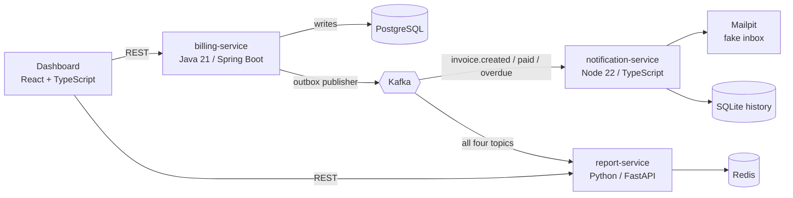

# Billing Platform

Microservices with Java, Node.js, Python and Kafka. Small businesses issue invoices, track payments and notify
customers. Built to practice event-driven architecture, not because a system this small needs four services
(it could be one, and I know that).



Only `billing-service` writes to PostgreSQL and publishes events. The other services just react to them, so each one
can fail or be replaced without taking the others down. No service reads another service's database.

## Run it

Requires Docker.

```bash
docker compose up --build
```

| What | URL |
|---|---|
| Dashboard | http://localhost:5173 |
| Billing API | http://localhost:8080 |
| Report API | http://localhost:8000/docs |
| Notification API | http://localhost:3000/notifications?customerId=... |
| Fake inbox (Mailpit) | http://localhost:8025 |
| Kafka UI | http://localhost:8090 |

Try it: create a customer (use a valid CPF such as `529.982.247-25`), issue an invoice, mark it as paid, then look at
the e-mail in Mailpit and at the numbers on the dashboard.

Low on memory? Start only part of the stack: `docker compose up postgres kafka billing-service`.

## Design decisions (the interesting part)

* **Money in cents** (`amountCents`, `BIGINT`), never a decimal, to avoid rounding errors.
* **Transactional Outbox.** An invoice and its event are written in the same database transaction. A polling
  publisher sends unpublished rows to Kafka afterwards, so an event is never lost if the service crashes between
  "save" and "send". Nothing else talks to Kafka, not even the daily overdue job.
* **At-least-once delivery + idempotent consumers.** The publisher may send an event twice; every consumer stores
  the `eventId`s it processed and ignores repeats. In the report service the "processed" mark and the numbers are
  updated in one Redis transaction.
* **Ordering by key.** The Kafka key is the `invoiceId`, so all events of one invoice stay in order.
* **Report numbers are rebuildable.** Topics have infinite retention (`retention.ms=-1`) and Redis runs with AOF. If
  the numbers are lost, `python -m app.rebuild` wipes them (including the processed-ids list) and replays the topics
  from the beginning.
* **State per invoice in the report service.** Events do not carry the previous status, so the report service keeps
  each invoice's status. That is how `OVERDUE -> PAID` leaves the overdue total and `CANCELED` leaves the open total.
* **Business rules** are documented in the status table below and covered by tests; due dates are calendar days
  evaluated in `America/Sao_Paulo`; concurrent "pay" clicks are blocked by optimistic locking (`@Version`).
* **Correlation id.** `X-Correlation-Id` enters at the HTTP request, is copied into the event, and appears in the
  JSON logs of every service. Logs never contain CPF/CNPJ or full e-mail addresses.

### Invoice status rules

| From | Action | Result |
|---|---|---|
| OPEN | pay | PAID (`invoice.paid`) |
| OPEN | cancel | CANCELED (`invoice.canceled`) |
| OPEN | daily job, due date passed | OVERDUE (`invoice.overdue`) |
| OVERDUE | pay | PAID (`invoice.paid`) |
| OVERDUE | cancel | CANCELED (`invoice.canceled`) |
| PAID / CANCELED | pay or cancel | refused, `409 Conflict` |

An invoice with a due date in the past, a non-positive amount, or an invalid CPF/CNPJ is refused with `400`.
Event format: [contracts/events.md](contracts/events.md).

## Services

| Service | Stack | Tests |
|---|---|---|
| `services/billing` | Java 21, Spring Boot 3.4, JPA, Flyway, Spring Kafka | JUnit 5, Testcontainers |
| `services/notification` | Node 22, TypeScript, Fastify, KafkaJS, SQLite | Vitest |
| `services/report` | Python 3.12, FastAPI, aiokafka, Redis | pytest, fakeredis |
| `dashboard` | React 18, TypeScript, Vite, TanStack Query, Recharts | Vitest |

Billing API: `POST /customers`, `GET /customers`, `GET /customers/{id}`, `POST /invoices`,
`GET /invoices?status=OPEN`, `POST /invoices/{id}/pay`, `POST /invoices/{id}/cancel`.
Report API: `GET /reports/summary`, `GET /reports/monthly?year=`, `GET /reports/overdue`.
Notification API: `GET /notifications?customerId=`. All services expose `GET /health`.

## Develop and test

```bash
# billing (needs Java 21 and Docker for the integration test)
cd services/billing && mvn verify

# notification
cd services/notification && npm ci && npm run lint && npm test

# report
cd services/report && pip install -r requirements-dev.txt && pytest

# dashboard
cd dashboard && npm ci && npm run lint && npm test && npm run build
```

CI: one GitHub Actions workflow per service (only runs when that folder changes): lint, tests, and on `main` a
Docker image published to the GitHub Container Registry.

Rebuild the report numbers:

```bash
docker compose stop report-service
docker compose run --rm report-service python -m app.rebuild
docker compose start report-service
```

## Kubernetes (optional)

Runs the four services in a local [kind](https://kind.sigs.k8s.io/) cluster; PostgreSQL, Redis, Kafka and Mailpit
stay in Compose. Pods reach them through `host.docker.internal` (works on Docker Desktop; on Linux add a host
mapping for it).

```bash
docker compose up -d postgres redis kafka mailpit
docker build -t billing-service:local services/billing
docker build -t notification-service:local services/notification
docker build -t report-service:local services/report
docker build -t dashboard:local dashboard
kind create cluster --name billing --config k8s/kind-config.yaml
for i in billing-service notification-service report-service dashboard; do kind load docker-image $i:local --name billing; done
kubectl apply -f k8s/
```

## AWS (optional)

Static dashboard on S3 + CloudFront, billing on App Runner or a small EC2. Create an AWS Budgets alert first:
managed Kafka and databases are not free. The complete demo runs locally.

## Out of scope for the MVP

Real payments (PIX/boleto), tax invoices, multiple companies and user authentication (no login: a deliberate MVP
choice, not an oversight).
