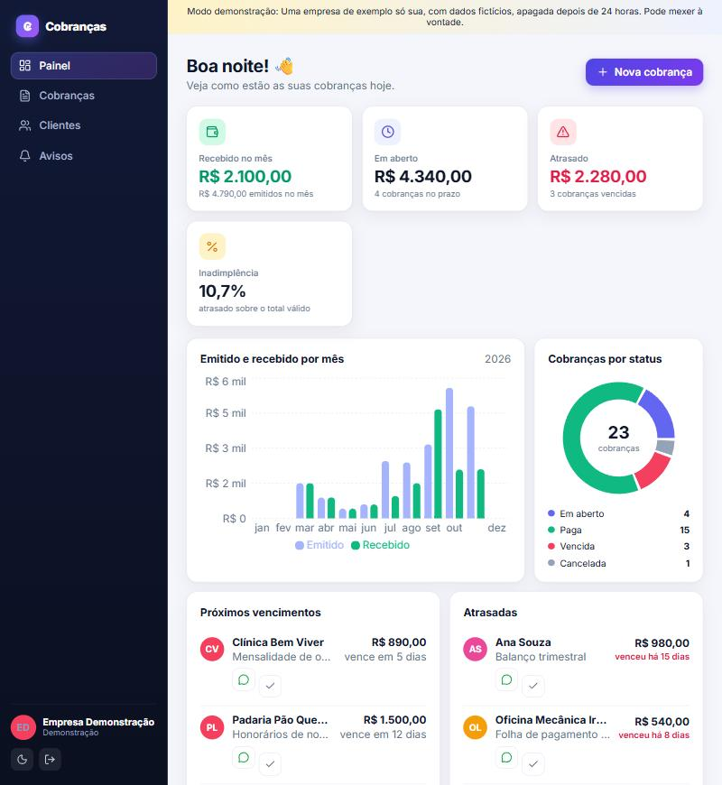
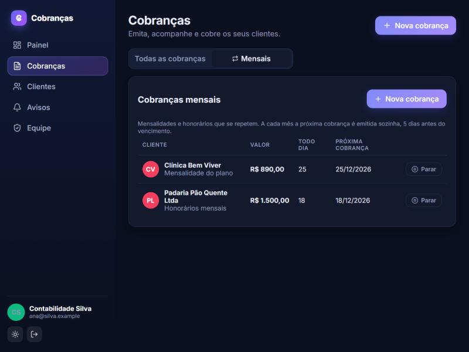
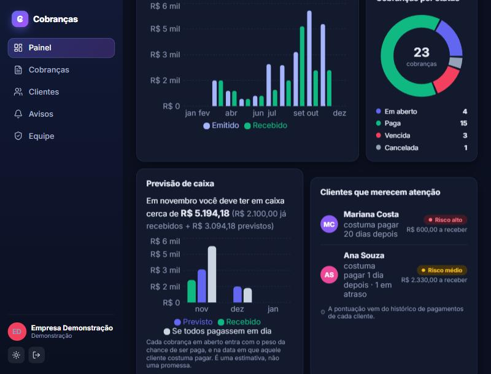
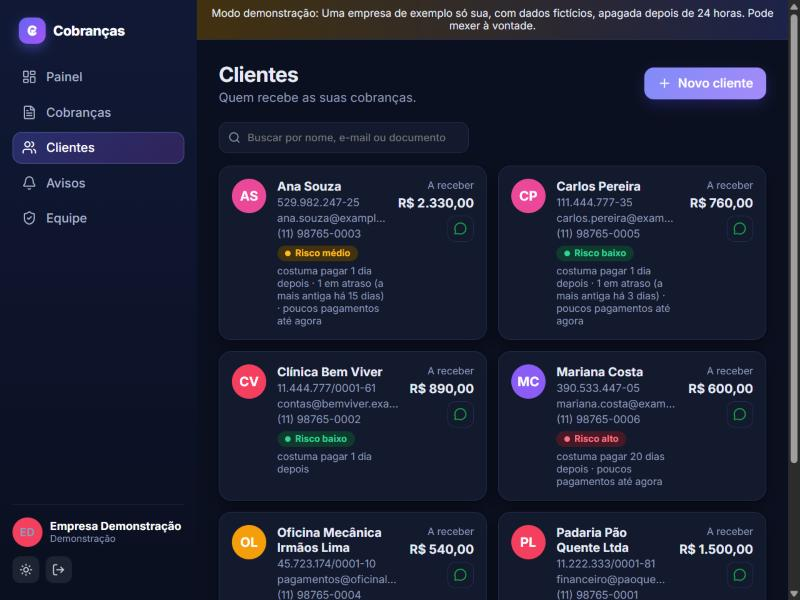
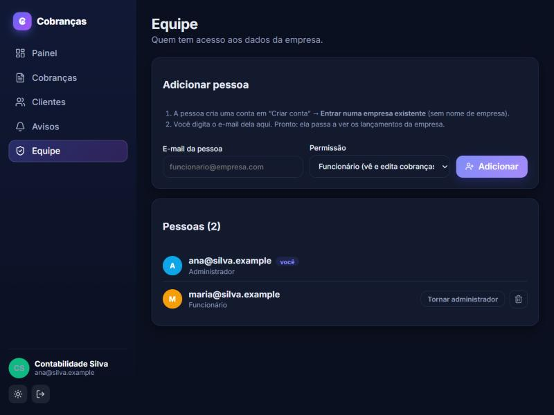
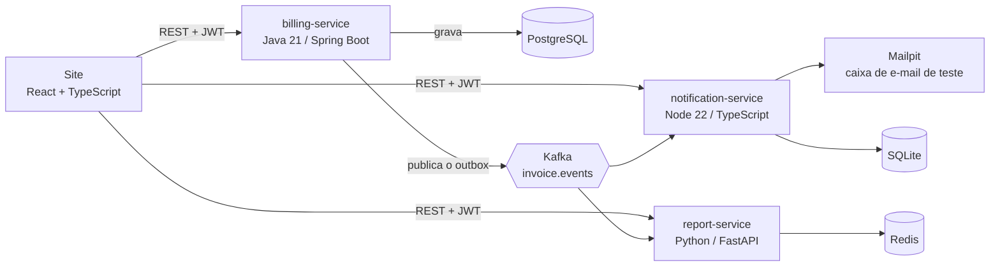

<p align="center"></p>

<h1 align="center">CobraAí</h1>

**Cobranças sem planilha, pagamentos sem susto.** Sistema de cobranças para pequenas empresas: emite cobranças, repete
as mensais, acompanha quem pagou, mostra quem tende a atrasar e abre o WhatsApp do cliente com a mensagem pronta.

[](https://github.com/MarcosFso/cobraai/actions/workflows/billing.yml)
[](https://github.com/MarcosFso/cobraai/actions/workflows/report.yml)
[](https://github.com/MarcosFso/cobraai/actions/workflows/notification.yml)
[](https://github.com/MarcosFso/cobraai/actions/workflows/web.yml)


## Demonstração ao vivo

### https://cobraai-wake.vercel.app

Esse endereço fica sempre no ar. Se o sistema estiver em repouso, a página o **acorda sozinha em cerca de 1 minuto** e abre a
demonstração. (Endereço direto: https://cobraai.chilecentral.cloudapp.azure.com, que só responde com o sistema ligado.)

Clique em **Entrar como visitante**: você ganha uma empresa de exemplo só sua, com clientes, cobranças, gráficos,
previsão de caixa e risco por cliente. Também dá para criar a conta de uma empresa de verdade (e-mail e senha).

> **Aviso: isto é uma demonstração de portfólio.** Não cadastre dados reais de clientes (CPF, CNPJ, telefone ou
> e-mail de pessoas reais), nem use uma senha que você usa em outro lugar. As empresas de visitante são apagadas
> sozinhas depois de 24 horas, e nenhum e-mail ou mensagem real é enviado.
>
> O servidor roda em créditos gratuitos de estudante e **desliga sozinho depois de 3 horas sem uso**; o primeiro acesso
> depois disso espera cerca de 1 minuto. Se algo não abrir, os prints abaixo e o [guia de uso](docs/GUIA-DE-USO.md)
> mostram o sistema funcionando.



## Como avaliar em 5 minutos

1. Abra **https://cobraai-wake.vercel.app**. Se o sistema estiver em repouso, clique em **Abrir o CobraAí** e espere cerca de 1 minuto.
2. Clique em **Entrar como visitante**. Você recebe uma empresa de exemplo só sua (clientes, cobranças e histórico de meses).
3. No **Painel**, veja o gráfico, a **previsão de caixa** (recebido, previsto e "se todos pagassem em dia") e os **clientes que merecem atenção**.
4. Em **Cobranças**, clique em **Nova cobrança**, escolha **Todo mês** e veja a cobrança aparecer na lista **Mensais**.
5. Em **Clientes**, veja o selo de **risco** de cada um e o botão verde que abre o **WhatsApp** com a mensagem pronta.
6. Para testar a **equipe**, saia, escolha **Criar conta → Criar minha empresa** e abra **Equipe** (o visitante não tem equipe, de propósito).
7. Para ver o código: o serviço Java em [`services/billing`](services/billing), os eventos em [`contracts/events.md`](contracts/events.md) e os testes de ponta a ponta em [`scripts/e2e`](scripts/e2e).

## O que o sistema faz

| | |
|---|---|
| **Cobranças** | Emissão com valor em centavos, vencimento, filtros e busca. Pagar, cancelar e marcar como vencida sozinha. |
| **Cobrar pelo WhatsApp** | Cada cliente tem telefone validado. Um botão abre a conversa com a mensagem pronta (simpática antes do vencimento, firme depois). |
| **Cobranças mensais** | "Todo mês": a primeira sai na hora e as próximas saem sozinhas 5 dias antes de cada vencimento, respeitando o dia (31 vira 28 em fevereiro). |
| **Várias pessoas por empresa** | Funcionário cria a conta, o administrador libera pelo e-mail e ele passa a ver os dados da empresa. Papéis de administrador e funcionário. |
| **Senha sem e-mail** | O administrador gera uma senha temporária; a pessoa é obrigada a trocá-la no próximo acesso. |
| **Risco e previsão de caixa** | Score de 0 a 100 por cliente a partir do histórico de pagamentos e uma previsão de caixa para 3 meses, com regras que dá para explicar. |
| **Avisos aos clientes** | Cada cobrança criada, paga ou vencida gera um e-mail (numa caixa de teste, nesta demonstração). |
| **Painel** | Recebido, em aberto, atrasado, inadimplência, gráfico por mês e cobranças por situação, atualizados sozinhos. |

| | |
|---|---|
|  |  |
|  |  |

## Tecnologias

| Área | O que foi usado |
|---|---|
| **Java 21** | Spring Boot 3.4, Spring Security com JWT, JPA, Flyway, Spring Kafka, JUnit 5 e Testcontainers |
| **Kafka** | Padrão *outbox*, entrega pelo menos uma vez com consumidores idempotentes, ordem por chave, reprocessamento |
| **Python 3.12** | FastAPI, aiokafka, Redis, PyJWT, pytest |
| **Node 22 e TypeScript** | Fastify, KafkaJS, SQLite, Vitest |
| **Front-end** | React 18, TypeScript, Vite, TanStack Query, Recharts, tema claro e escuro, celular |
| **Dados** | PostgreSQL (migrações versionadas), Redis com AOF |
| **Infra** | Docker e Docker Compose, Caddy (HTTPS automático), Kubernetes (manifestos), GitHub Actions |
| **Nuvem** | Azure (máquina virtual de 4 GB, plano de estudante), IP fixo, desligamento por inatividade |

## Arquitetura



Só o serviço de cobranças escreve no PostgreSQL e publica eventos. Os outros dois apenas reagem a eles, então cada
um pode cair ou ser trocado sem derrubar os demais, e nenhum serviço lê o banco de outro. Um mesmo login (JWT assinado
pelo serviço Java) vale nos três serviços.

## Decisões técnicas (a parte interessante)

* **Dinheiro em centavos** (`BIGINT`), nunca decimal, para não ter erro de arredondamento.
* **Transactional Outbox.** A cobrança e o seu evento são gravados na mesma transação. Um publicador lê o que ainda não
  foi enviado e manda ao Kafka, então nenhum evento se perde se o serviço cair entre "salvar" e "enviar".
* **Entrega pelo menos uma vez + consumidores idempotentes.** O mesmo evento pode chegar duas vezes; cada consumidor
  guarda os `eventId` que já processou. No serviço de relatórios, a marca de "processado" e os números mudam numa
  única transação do Redis.
* **Um tópico só (`invoice.events`), chave = `invoiceId`.** O Kafka só garante ordem dentro de uma partição. Na primeira
  versão havia um tópico por tipo de evento e o painel mostrava números errados, porque o "vencida" podia chegar antes do
  "criada". Com um tópico e a chave da cobrança, os eventos de uma cobrança chegam em ordem.
* **Relatórios reconstruíveis.** Os tópicos guardam as mensagens para sempre e, se o Redis for perdido, `python -m
  app.rebuild` refaz todos os números a partir dos eventos.
* **Isolamento entre empresas.** A empresa vem **do token**, nunca do pedido. Pedir a cobrança de outra empresa responde
  `404`, como se ela não existisse. Um teste com duas empresas, tokens adulterados e tokens assinados com outro segredo
  confere que nada vaza no Java, no Kafka, nos relatórios e nos avisos.
* **Quem sai perde o acesso na hora.** O serviço Java confere empresa e papel no banco a cada pedido; os outros dois
  confiam no token, que dura 4 horas.
* **Previsão por regras, não por modelo.** O score soma o peso de pagar atrasado, a média de dias de atraso e o que está
  vencido agora; a previsão pesa cada cobrança pela chance de ser paga. Cada número pode ser explicado ao usuário.
* **Concorrência.** Dois cliques simultâneos em "pagar" são barrados por bloqueio otimista (`@Version`); a rotina das
  cobranças mensais usa a mesma coluna para nunca emitir o mesmo mês duas vezes.

As regras de cada serviço e o formato dos eventos estão em [contracts/events.md](contracts/events.md).

## Rodar na sua máquina

Precisa só do Docker.

```bash
docker compose up --build
```

| O quê | Endereço |
|---|---|
| Site | http://localhost:5173 |
| API de cobranças | http://localhost:8080 |
| API de relatórios | http://localhost:8000/docs |
| Caixa de e-mail de teste (Mailpit) | http://localhost:8025 |
| Kafka UI | http://localhost:8090 |

Abra o site e clique em **Entrar como visitante**. O passo a passo, com imagens, está em
[docs/GUIA-DE-USO.md](docs/GUIA-DE-USO.md).

## Testes

| Camada | Quantidade | Como rodar |
|---|---|---|
| Java (unidade e integração com PostgreSQL real, via Testcontainers) | 51 | `cd services/billing && mvn verify` |
| Python (regras, Redis falso, API) | 34 | `cd services/report && pip install -r requirements-dev.txt && pytest` |
| Node (consumidor, idempotência, API) | 13 | `cd services/notification && npm ci && npm test` |
| Site (telas completas sobre dados de exemplo) | 32 | `cd web && npm ci && npm test` |
| **Ponta a ponta, com tudo no ar** (isolamento, equipe, risco) | cerca de 100 verificações | [`scripts/e2e`](scripts/e2e/README.md) |

O GitHub Actions roda os testes de cada serviço quando a pasta dele muda. Na `main`, publica a imagem Docker no GitHub
Container Registry.

## Publicação (Azure, em 2 GB de memória)

A mesma pilha roda numa máquina virtual do Azure, atrás do Caddy (HTTPS automático). Foi dimensionada para poucos
recursos: cada contêiner tem um limite de memória, as JVMs usam heaps pequenos e o Kafka UI fica desligado até ser
preciso. Medido com carga (cerca de 85 usuários ao mesmo tempo): **1,2 GB** no pico, sem nenhum serviço morto. Há um
script que desliga a máquina sozinha quando ninguém usa o site, para o crédito render mais.

A página que acorda o servidor está em [`wake/`](wake/) (Vercel, funções que usam uma credencial de uma só permissão: ligar
essa máquina). Guias: [Azure](deploy/azure/GUIA-AZURE.md), [Oracle Cloud](deploy/GUIA-ORACLE.md), [visão geral do deploy](deploy/README.md).

## Quanto tempo a demonstração fica no ar (custo real)

A demonstração roda numa máquina virtual do Azure paga com o **crédito de US$ 100 do plano de estudante** (válido por 12 meses,
até 11/11/2027). Para o crédito render, a máquina **desliga sozinha depois de 3 horas sem uso** e a página
[`wake/`](wake/) a liga de novo em cerca de 1 minuto quando alguém aparece. Desligada, ela não cobra computação.

| | Valor |
|---|---|
| Máquina ligada (B2als_v2, 2 vCPU, 4 GB) | US$ 0,0526 por hora |
| Disco e IP fixo, ligada ou desligada | cerca de US$ 6 por mês |
| Cada acesso (liga, e fica ligada até 3 horas depois do último uso) | cerca de US$ 0,17 |

Quanto dura o crédito depende de quantas vezes alguém usa por mês (valores calculados com o preço de tabela do Azure):

| Uso | Horas ligada por mês | Custo por mês | Duração do crédito de US$ 100 |
|---|---|---|---|
| **Leve**: recrutadores esporádicos, cerca de 20 acessos | cerca de 70 h | cerca de US$ 10 | **cerca de 10 meses** (o crédito expira em 12) |
| **Moderado**: cerca de 2 acessos por dia | cerca de 210 h | cerca de US$ 17 | **cerca de 6 meses** |
| **Intenso**: alguém usa a cada poucas horas, sempre ligada | 730 h | cerca de US$ 44 | **cerca de 2,3 meses** |

Para um projeto de portfólio durante uma busca de emprego, o esperado é entre **6 e 10 meses**. Esses números são estimativas:
o gasto real aparece em *Gerenciamento de custos* no portal do Azure, e há um alerta de orçamento configurado para avisar
antes de o crédito acabar. Robôs da internet não contam como uso: só pedidos reais ao sistema mantêm a máquina ligada.

**Quando o crédito acabar**, a máquina para e o link da página de entrada deixa de ligar o sistema. O plano é: este
repositório continua público, com os [prints](docs/GUIA-DE-USO.md) e os testes; o sistema roda com um comando em qualquer
computador com Docker; e a versão leve com Supabase e Vercel (`web/`), que não tem prazo, passa a ser o link principal.

## Limitações e próximos passos

Isto é um projeto de portfólio, e algumas coisas ficaram de fora de propósito:

* Sem **Pix, boleto ou nota fiscal**: a baixa de pagamento é manual.
* **WhatsApp**: o botão abre uma conversa pronta; enviar sozinho exigiria a API paga do WhatsApp Business.
* Falta **confirmação de e-mail** e **recuperação de senha por e-mail** (hoje o administrador redefine, ou o dono pelo
  servidor). Também não há **limite de tentativas** no login e no cadastro.
* A versão com Supabase e Vercel (`web/`) existe no código, mas ainda não está publicada e não tem equipe, cobranças
  mensais nem risco.
* Próximos passos naturais: Pix com baixa automática, régua de cobrança automática (lembretes por e-mail antes e depois
  do vencimento) e monitoramento (Prometheus e Grafana).

## Estrutura

```
services/billing        Java 21 / Spring Boot: cobranças, clientes, login, equipe, mensais, outbox
services/report         Python / FastAPI: totais, gráficos, risco e previsão, a partir dos eventos
services/notification   Node / TypeScript: avisos por e-mail a partir dos eventos
web                     React + TypeScript: o site (e uma versão alternativa com Supabase)
deploy                  Docker Compose de produção, Caddy, scripts de instalação (Azure e Oracle)
k8s                     Manifestos de Kubernetes (cluster local com kind)
contracts               Formato dos eventos do Kafka
scripts/e2e             Testes de ponta a ponta contra o sistema no ar
docs                    Guia de uso com imagens
```

## Documentação

[Guia de uso](docs/GUIA-DE-USO.md) · [Eventos do Kafka](contracts/events.md) · [Deploy no Azure](deploy/azure/GUIA-AZURE.md) · [Versão em inglês](README.en.md)

## Autor

Marcos Ribeiro ([@MarcosFso](https://github.com/MarcosFso)). Licença [MIT](LICENSE).
