# Guia de uso, passo a passo (com imagens)

Este guia mostra o sistema como o usuário vê, tela por tela. As imagens são da versão com Java, Kafka, Python e
Node.js, mas o site é o mesmo na versão do Vercel e Supabase.

## 1. Entrar

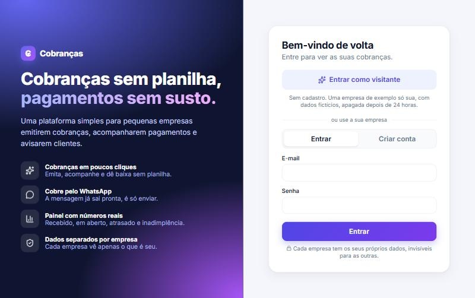

Há três caminhos:

* **Entrar como visitante** (botão azul-claro): cria uma empresa de exemplo só sua, com dados fictícios, sem cadastro.
  Serve para conhecer o sistema. Ela é apagada depois de 24 horas.
* **Criar conta**: cadastra a sua empresa com e-mail e senha (mínimo de 8 caracteres). Cada empresa vê apenas os
  próprios dados.
* **Entrar**: para quem já tem conta.

### Criar a conta da sua empresa

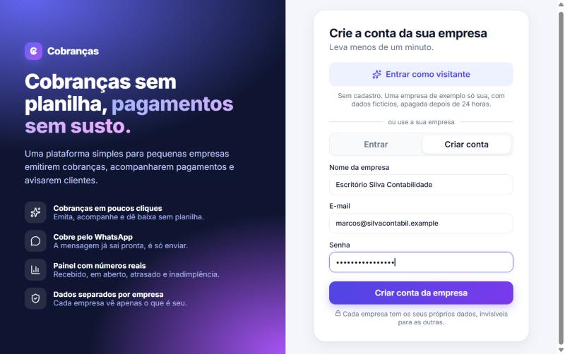

Preencha o nome da empresa, o e-mail e uma senha, e clique em **Criar conta da empresa**. Você entra direto.

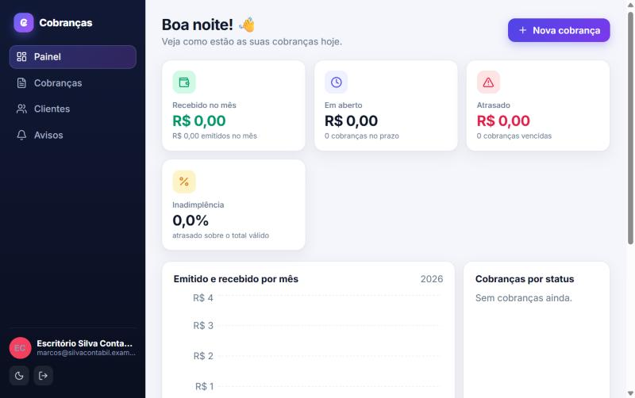

Uma empresa nova começa vazia, com tudo zerado. Não aparece o aviso amarelo de demonstração.

## 2. O painel

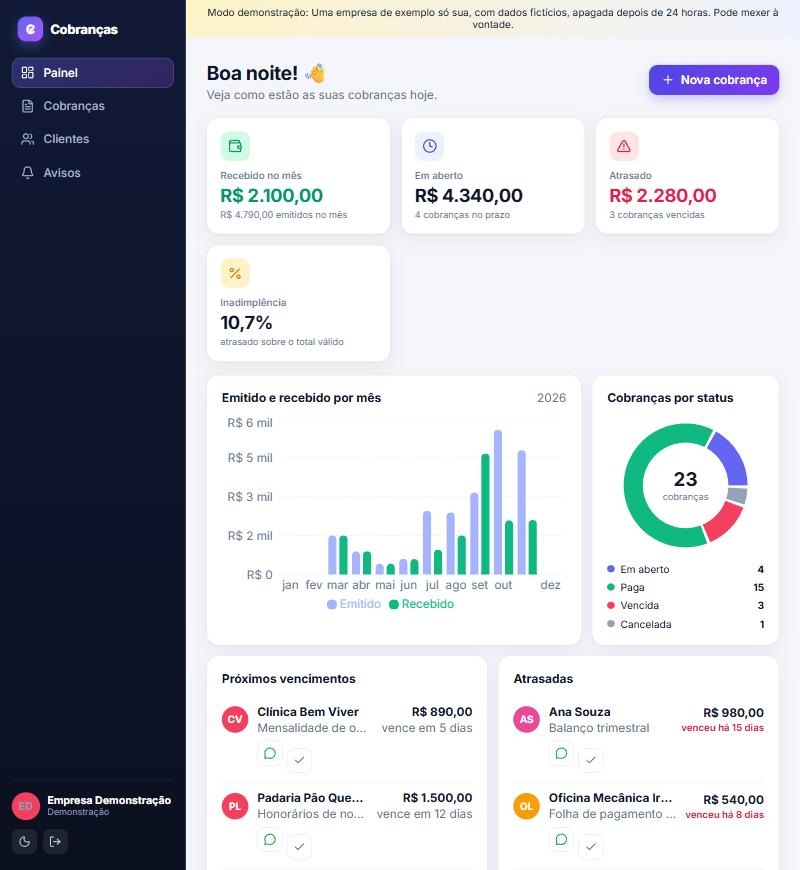

* **Cartões do topo**: quanto foi recebido no mês, quanto está em aberto, quanto está atrasado e a inadimplência
  (atrasado dividido pelo total válido).
* **Gráfico**: o que foi emitido (azul-claro) e recebido (verde) em cada mês.
* **Rosca**: quantas cobranças há em cada situação.
* **Próximos vencimentos** e **Atrasadas**: as cobranças que pedem atenção, com os botões de cobrar.

Os números são calculados pelo serviço de relatórios a partir dos eventos do Kafka e se atualizam sozinhos a cada
poucos segundos.

### Previsão de caixa e clientes que merecem atenção

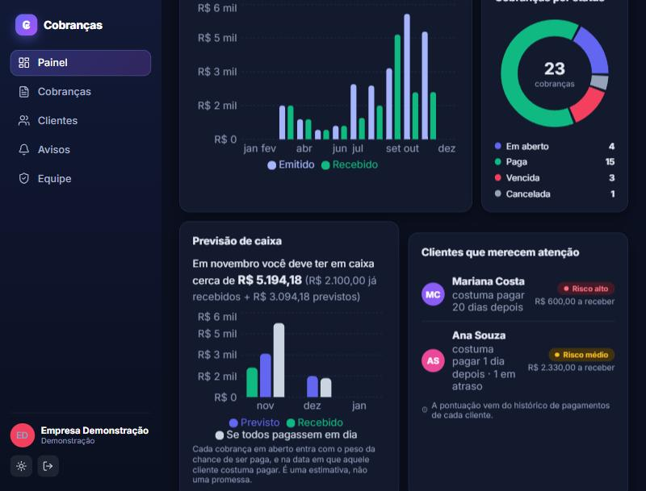

No fim do painel há duas áreas que olham para o **futuro**:

* **Previsão de caixa**: quanto você deve ter em caixa neste mês e nos próximos dois. As barras comparam o que já foi
  **recebido** (verde), o que é **previsto** (roxo) e o que entraria **se todos pagassem em dia** (cinza). Cada cobrança
  em aberto entra com o peso da chance de ser paga, no mês em que aquele cliente costuma pagar. É uma estimativa, não
  uma promessa.
* **Clientes que merecem atenção**: quem tem risco médio ou alto de pagar atrasado, para você saber com quem falar
  primeiro.

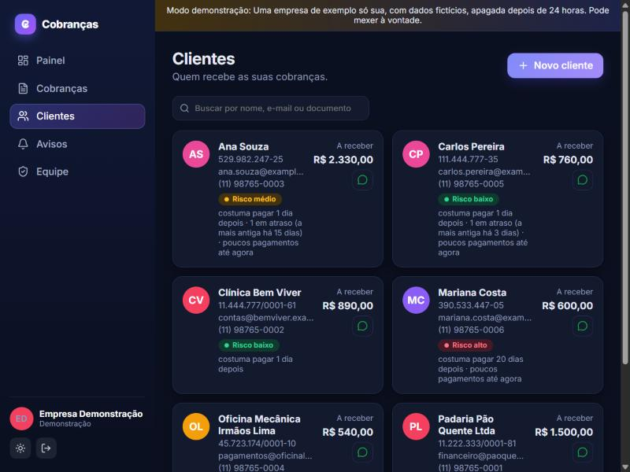

Cada cliente tem um selo de **risco baixo, médio ou alto** e uma frase como "costuma pagar 9 dias depois". Passe o
mouse no selo para ver a pontuação (0 a 100). Como é calculado:

* **Quanto ele atrasa:** pagar até 3 dias depois do vencimento não conta como atraso. Pagar mais tarde conta, e a média
  de dias de atraso pesa.
* **Quantas vezes atrasa:** a proporção de cobranças pagas com atraso.
* **O que está vencido agora:** cada cobrança vencida soma pontos, e as mais antigas somam mais.
* Cliente sem pagamentos aparece como "Sem histórico". Com menos de 3 pagamentos a nota é só um indício
  ("poucos pagamentos até agora").
* O painel precisa de histórico: quanto mais cobranças pagas, melhor a previsão.

## 3. Cadastrar um cliente

Abra **Clientes** e clique em **Novo cliente**.

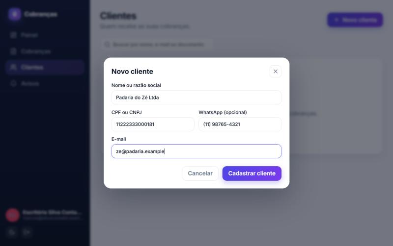

* **Nome ou razão social** e **e-mail** são obrigatórios.
* **CPF ou CNPJ** é conferido pelos dígitos verificadores: um número inválido é recusado.
* **WhatsApp** é opcional, mas é ele que habilita o botão de cobrança. Digite só os números, com DDD
  (por exemplo `11987654321`); o campo formata sozinho como `(11) 98765-4321`.

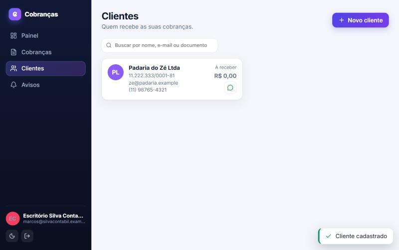

O mesmo CPF/CNPJ pode ser cliente de duas empresas diferentes, mas não duas vezes na mesma empresa.

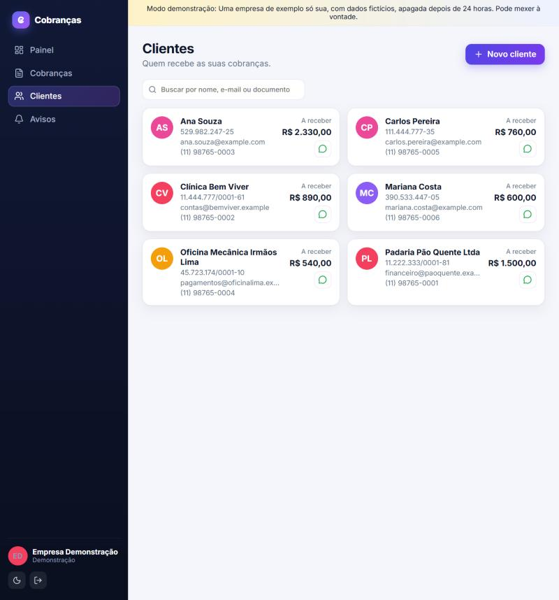

Cada cartão mostra quanto o cliente ainda deve ("A receber") e o botão verde de conversa no WhatsApp.

## 4. Emitir uma cobrança

Abra **Cobranças** e clique em **Nova cobrança**.

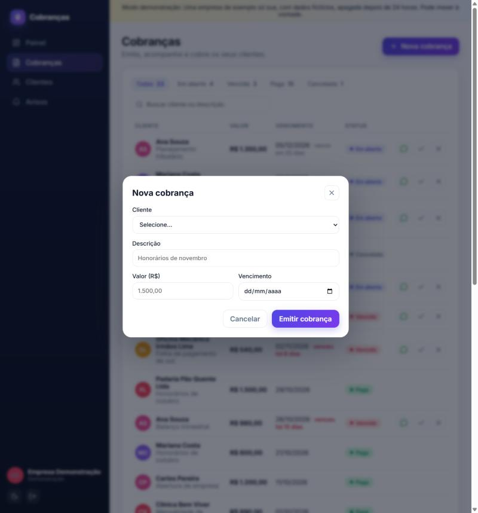

* Escolha o **cliente** e escreva a **descrição** (por exemplo, "Honorários de novembro").
* **Valor**: digite como no dia a dia (`1.500,00`). O sistema guarda em centavos.
* **Vencimento**: não pode ser uma data passada.

## 5. Acompanhar, cobrar e dar baixa

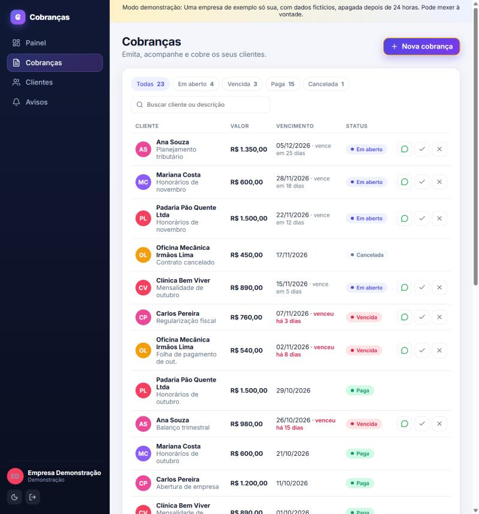

* Para uma cobrança que se repete, veja a seção "Cobranças que se repetem todo mês" mais abaixo.
* Use os filtros no alto (**Todas**, **Em aberto**, **Vencida**, **Paga**, **Cancelada**) e a busca por cliente ou
  descrição.
* Em cada cobrança em aberto ou vencida há três botões:
  * **Balão verde, cobrar pelo WhatsApp**: abre o WhatsApp com a conversa do cliente e a mensagem já escrita. Antes do
    vencimento a mensagem é um lembrete simpático; depois do vencimento fica mais firme. Você só confere e aperta
    enviar. O botão fica apagado se o cliente não tem telefone.
  * **Visto, marcar como paga**: dá baixa. A cobrança vira "Paga" e o cliente recebe o aviso de pagamento.
  * **X, cancelar**: cancela a cobrança, depois de uma confirmação.
* Uma cobrança paga ou cancelada não pode ser paga nem cancelada de novo.
* Quando o vencimento passa, a cobrança vira **Vencida** sozinha (uma rotina diária do serviço em Java faz isso).

### Cobranças que se repetem todo mês

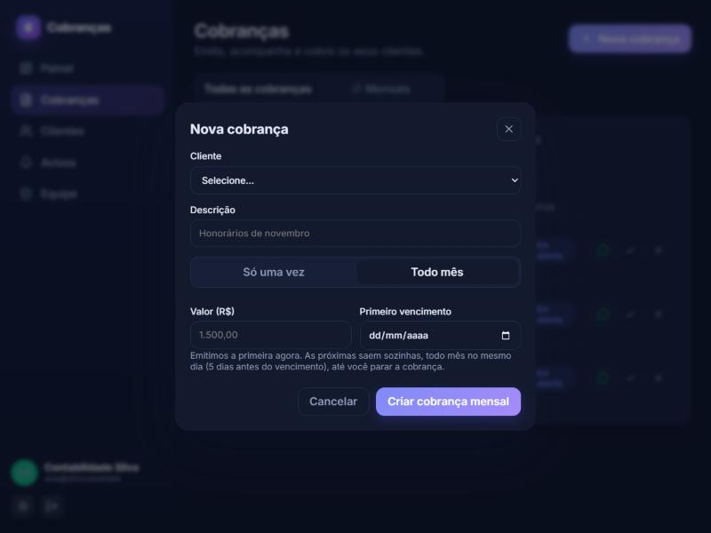

Mensalidades e honorários não precisam ser emitidos de novo a cada mês. Em **Nova cobrança**, escolha **Todo mês**:

* O campo de data vira **Primeiro vencimento**. A primeira cobrança é emitida na hora.
* As próximas saem **sozinhas, 5 dias antes de cada vencimento**, sempre no mesmo dia do mês. Se o dia não existe no
  mês (31 em fevereiro), usa o último dia, e volta ao 31 depois.
* Cada cobrança nova passa pelo mesmo caminho das outras: o Java grava o evento, o Kafka entrega e o painel atualiza.
* Escolha **Só uma vez** para uma cobrança comum.

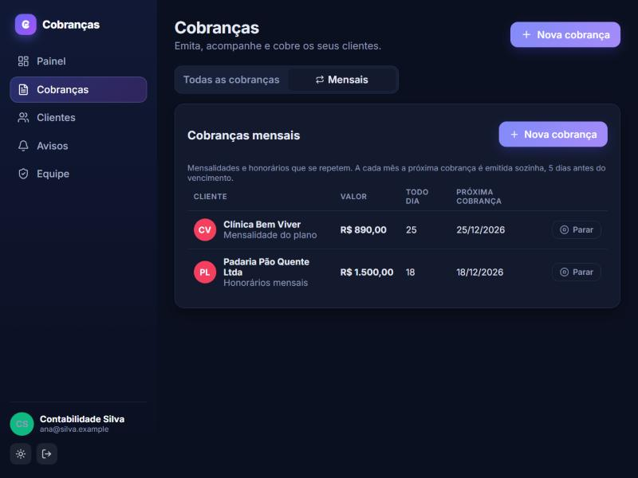

Em **Cobranças → Mensais** você vê tudo o que se repete, o dia e a próxima cobrança. O botão **Parar** encerra as
próximas emissões; o que já foi emitido continua. Nas listas, as cobranças que vieram de uma recorrência têm o ícone de
setas circulares ao lado da descrição.

## 6. Avisos aos clientes

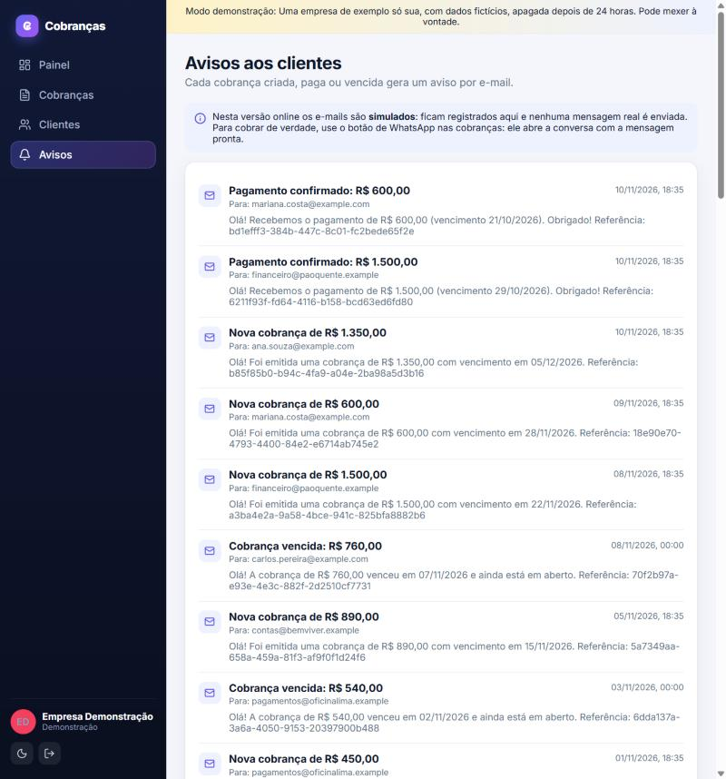

Cada cobrança criada, paga ou vencida gera um aviso por e-mail ao cliente. O serviço em Node.js consome os eventos do
Kafka e registra aqui o que foi enviado. Nesta demonstração os e-mails vão para uma caixa de e-mail de teste
(Mailpit), e nenhuma mensagem real sai. Para cobrar de verdade, use o botão de WhatsApp.

## 7. Modo escuro e celular

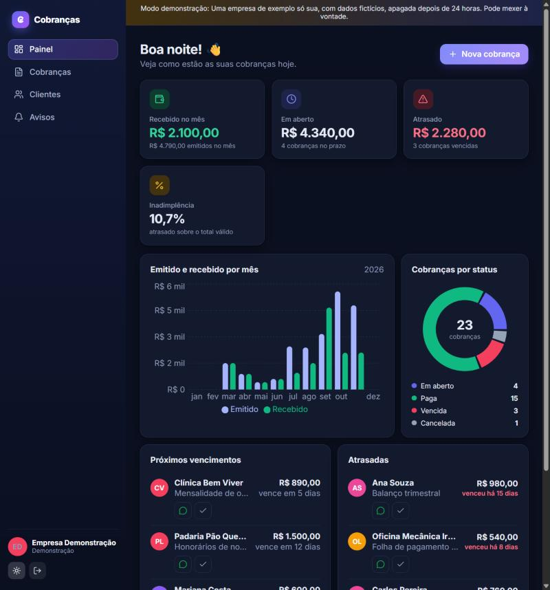

O botão de lua, no canto inferior esquerdo, alterna entre o tema claro e o escuro (o sistema lembra a sua escolha).

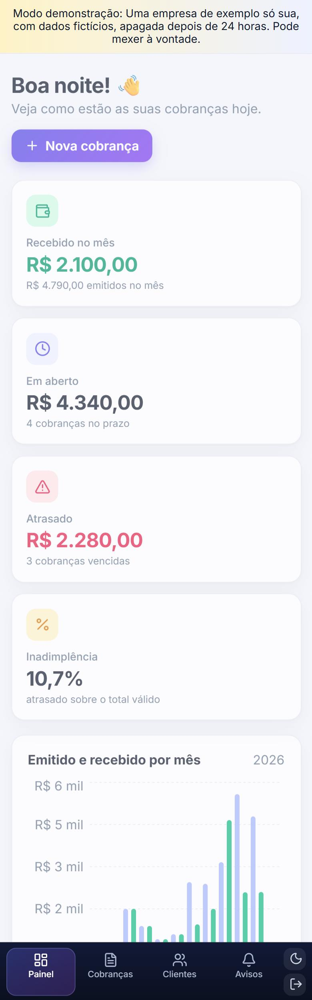

No celular o menu vira uma barra de navegação na parte de baixo, e as tabelas viram cartões.

## 8. Equipe: vários usuários na mesma empresa

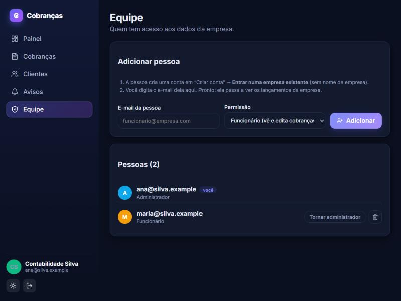

Para um funcionário ver as cobranças e os clientes da empresa:

1. **A pessoa** abre o site, clica em **Criar conta**, escolhe **Entrar numa empresa**, digita e-mail e senha e cria a
   conta (sem nome de empresa).

   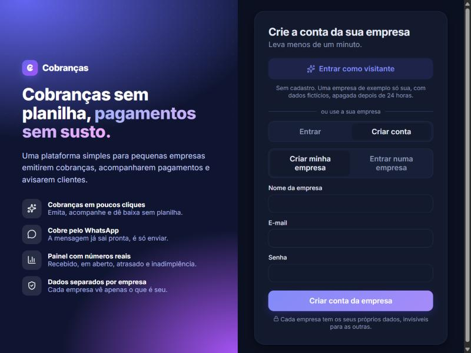

2. Ela cai na tela **Aguardando liberação**. Ela confere sozinha de tempos em tempos.

   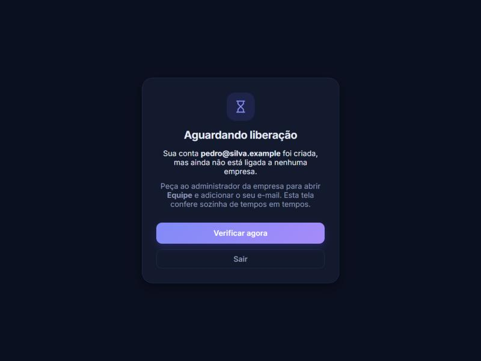

3. **O administrador** abre **Equipe**, digita o e-mail dela e clica em **Adicionar**. Pronto: a pessoa passa a ver os
   mesmos clientes, cobranças, painel e avisos da empresa.

Permissões:

* **Funcionário**: vê e edita clientes e cobranças. Não gerencia a equipe.
* **Administrador**: faz tudo isso e também adiciona e remove pessoas e troca a permissão de cada uma. A empresa
  sempre mantém pelo menos um administrador, e ninguém remove a si mesmo.
* Quem criou a empresa é o primeiro administrador.
* Ao remover uma pessoa, o acesso dela ao serviço de cobranças acaba na hora. Nos painéis de relatório e de avisos
  ela ainda pode ver os dados até o login expirar (no máximo 4 horas).
* Por segurança, a tela de adicionar responde igual para e-mail sem conta e para e-mail que já é de outra empresa, e
  só libera quem criou a conta sem empresa.
* Na demonstração a equipe fica desligada (a empresa é apagada em 24 horas).

### Esqueci a senha

Não há e-mail de recuperação. Quem resolve é o administrador:

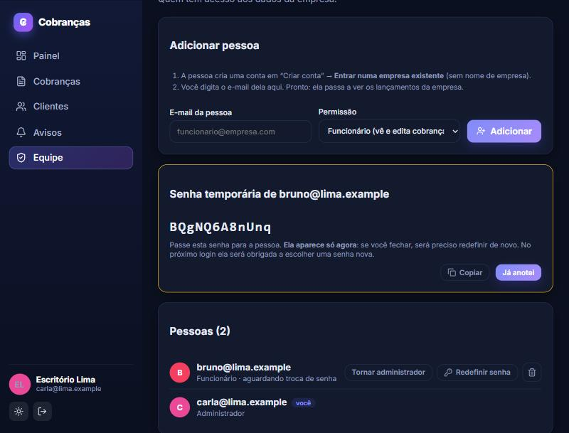

1. O administrador abre **Equipe** e clica em **Redefinir senha** ao lado da pessoa.
2. Aparece uma **senha temporária, uma única vez**. Ele copia e passa para a pessoa (pessoalmente, por WhatsApp...).
   A senha antiga deixa de valer na hora, e qualquer sessão aberta da pessoa é encerrada.
3. A pessoa entra com a senha temporária e vê o aviso **"O administrador mudou a senha da conta. Escolha uma nova
   agora"**. Nada mais abre até ela escolher a senha nova (mínimo de 8 caracteres, diferente da temporária).
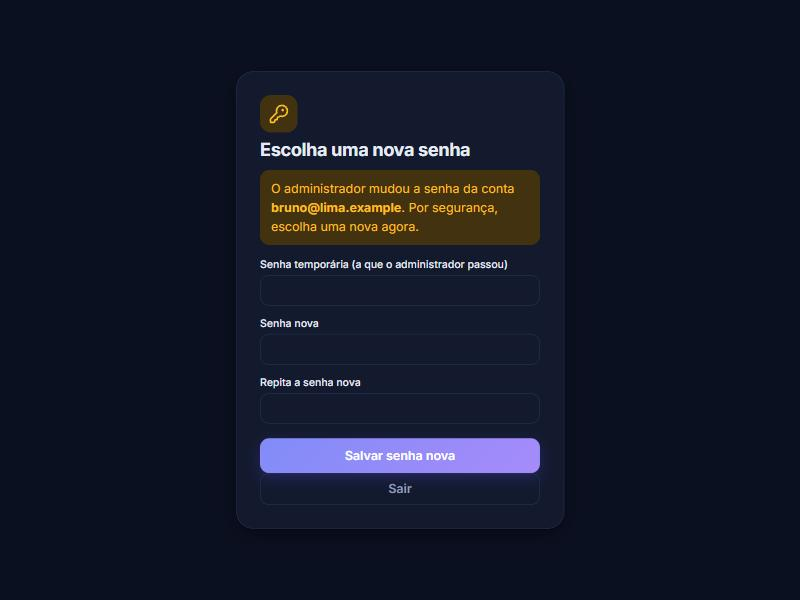

4. Na lista da equipe, quem ainda não trocou aparece com "aguardando troca de senha".

Outras regras:

* O administrador **não redefine a própria senha** por essa tela. Para trocar a sua, use **Equipe → Minha senha** (precisa
  da senha atual). Se você é o único administrador e esqueceu a senha, use o script do servidor, no fim deste guia.
* Uma pessoa de outra empresa nunca é afetada: o administrador só enxerga a própria equipe.

**Para o dono do sistema (esqueceu a própria senha).** No servidor da Oracle:

```bash
cd ~/cobraai
bash deploy/reset-password.sh seu-email@empresa.com
```

O script imprime uma senha temporária e a conta passa pela mesma tela de troca obrigatória.

## 9. Para mostrar numa entrevista

1. Entre como visitante e mostre o painel com números e o gráfico.
2. Cadastre um cliente com WhatsApp e emita uma cobrança.
3. Clique no balão verde: o WhatsApp abre com a mensagem pronta.
4. Marque como paga e veja os totais mudarem sozinhos: foi o Java gravando o evento, o Kafka entregando e o Python
   recalculando.
5. Ligue o Kafka UI (vem desligado para economizar memória, veja `deploy/GUIA-ORACLE.md`) e abra `/kafka` para mostrar a mensagem do evento e o Mailpit (`/mail`) para mostrar o e-mail que o
   serviço Node.js enviou.
